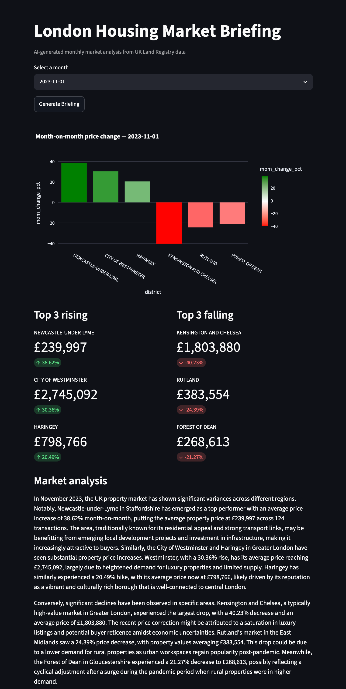
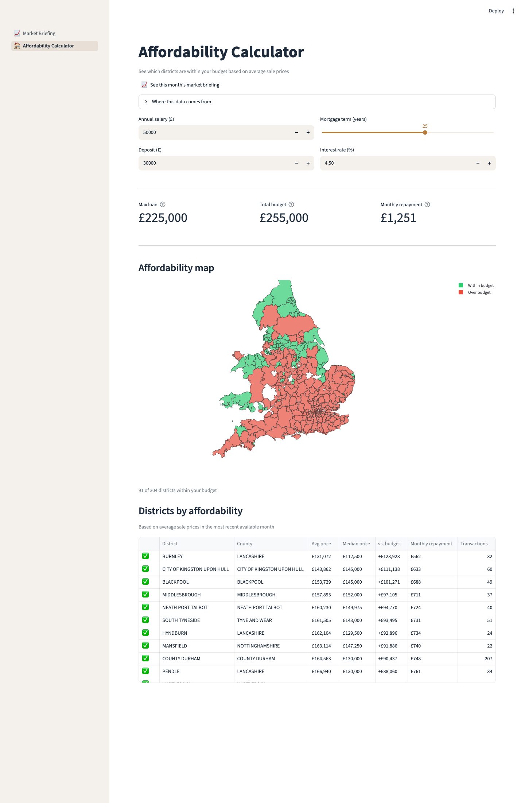
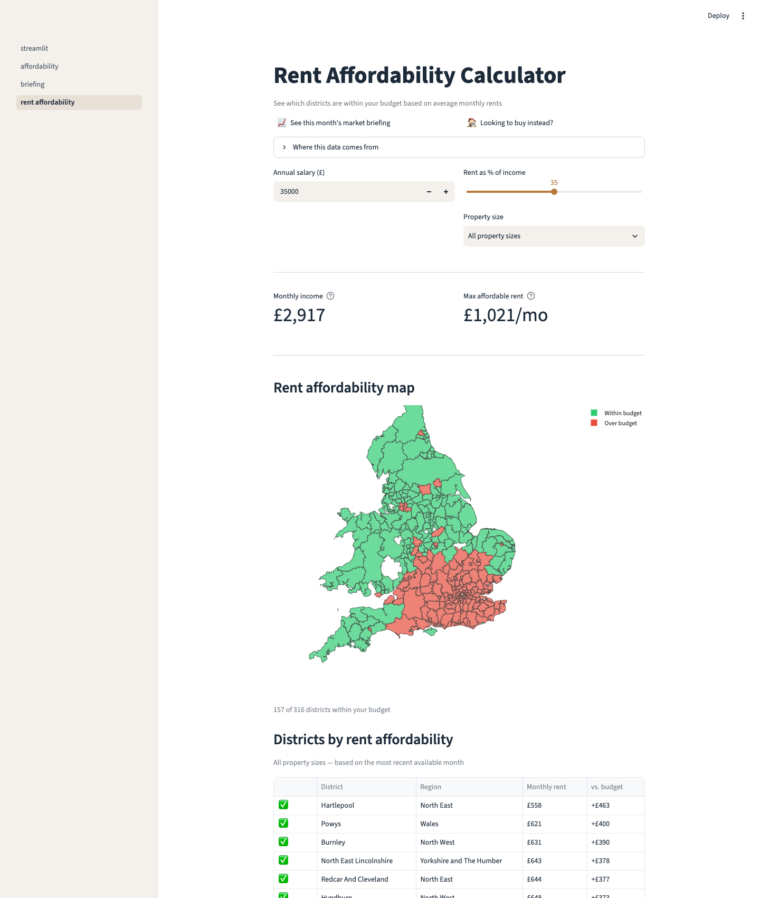

# London Housing — Analytics Engineering Pipeline

**Stack:** dbt · DuckDB · Python · S3 · Streamlit · OpenAI · Docker · GitHub Actions

See which UK districts you can actually afford to buy or rent in, and get an AI-written take on where prices are moving this month — backed by a real analytics engineering pipeline underneath. Ingests HM Land Registry Price Paid data, the UK House Price Index, and ONS rental statistics, transforms them through a layered dbt model, and surfaces them through a three-page Streamlit app.

## Live demo

**[housing.victorjohnson.dev](https://housing.victorjohnson.dev)**

## Streamlit app

**Market briefing** — an AI model ranks districts by month-on-month price change and writes a short, factual summary of what moved.



**Buy affordability calculator** — enter a salary, deposit, and mortgage terms to see which of the UK's 300+ districts are within budget on a live choropleth map.



**Rent affordability calculator** — same idea for renters: enter a salary and a target rent-to-income ratio, pick a property size, and see which districts fit on the same map pattern.



## Architecture

```text
S3 (raw CSVs)
    └── ingest/load_raw.py, load_rents.py   # loads raw_transactions, raw_hpi, raw_rents into DuckDB
        └── staging/             # clean column names, cast types, decode codes, normalise district names
            └── intermediate/    # filter non-market transfers, add price bands & date parts
                └── marts/       # fct_transactions, fct_price_index, fct_rents, dim_location, dim_property, dim_time
                    └── app/     # Streamlit reads from DuckDB → OpenAI generates briefing
```

## Data sources

| Source | Description |
| --- | --- |
| HM Land Registry Price Paid | Individual property transactions across England & Wales |
| UK House Price Index (HPI) | Monthly regional average prices and index values |
| ONS Price Index of Private Rents (PIPR) | Monthly local-authority average rents, England & Wales |

All three are ingested as CSV via S3 (`ingest/load_raw.py` for Land Registry/HPI, `ingest/load_rents.py` for ONS — the latter scrapes ONS's dataset page each run since, unlike Land Registry, it publishes no stable "latest" URL).

## Project structure

```text
london_housing/
├── ingest/
│   ├── load_raw.py                        # S3 → DuckDB ingestion (Land Registry, HPI)
│   ├── load_rents.py                      # scrapes ONS for the latest PIPR release → S3 → DuckDB
│   └── refresh.py                         # monthly incremental Land Registry refresh
├── models/
│   ├── staging/
│   │   ├── stg_transactions.sql           # decoded property types, tenure, address cleanup
│   │   ├── stg_hpi.sql                    # renamed HPI columns, buyer/transaction type splits
│   │   └── stg_rents.sql                  # renamed PIPR columns, district-name normalisation
│   ├── intermediate/
│   │   ├── int_transactions_enriched.sql  # filters non-market transfers, adds price bands
│   │   ├── int_price_index.sql            # monthly district aggregates with MoM change
│   │   └── int_rents_enriched.sql         # filters to local authorities, adds MoM change
│   └── marts/
│       ├── fct_transactions.sql
│       ├── fct_price_index.sql
│       ├── fct_rents.sql
│       ├── dim_location.sql
│       ├── dim_property.sql
│       └── dim_time.sql
├── app/
│   ├── streamlit.py                       # Streamlit UI entrypoint + theme
│   ├── queries.py                         # DuckDB query functions
│   ├── briefing_generator.py             # OpenAI market briefing
│   ├── calculators.py                     # Pure mortgage/rent-affordability math
│   ├── geo.py                             # Shared district boundary GeoJSON loader
│   ├── pages/                             # Market briefing, buy and rent affordability pages
│   ├── tests/                             # pytest suite for the app layer
│   └── .streamlit/config.toml             # Brand theme
└── utils/                                 # schema sniffing and bucket inspection scripts
```

## Quickstart

### 1. Environment setup

```bash
python -m venv env && source env/bin/activate
pip install -r requirements.txt -r requirements-pipeline.txt
```

### 2. Configure credentials

Create a `.env` file in the project root:

```env
AWS_KEY_ID=your_key
AWS_SECRET=your_secret
AWS_REGION=eu-west-2
AWS_BUCKET=victor-london-housing-analytics
OPENAI_API_KEY=your_key
```

### 3. Configure dbt profile

Add to `~/.dbt/profiles.yml`:

```yaml
london_housing:
  target: dev
  outputs:
    dev:
      type: duckdb
      path: ../london_housing.duckdb
      threads: 1
```

### 4. Run the pipeline

```bash
cd london_housing
python ingest/load_raw.py    # ingest Land Registry + HPI from S3
python ingest/load_rents.py  # ingest the latest ONS PIPR release
dbt run                      # build all models
dbt test                     # run data quality tests
```

### 5. Run the app

```bash
streamlit run london_housing/app/streamlit.py
```

## Testing & CI

- **dbt tests** — schema tests (`not_null`, `unique`, `accepted_values`, `relationships`) across staging, intermediate and mart models, including referential integrity between the fact and dimension tables and documented data-quality caveats (e.g. the postcode gaps in source data, and the handful of ONS-vs-Land-Registry district naming differences normalised in `stg_rents.sql`). Run with `dbt test`.
- **pytest** — unit tests for the Python app layer: the mortgage and rent affordability calculators, the DuckDB query functions (against a fixture database), and the AI briefing generator (with the OpenAI client mocked). Run with `cd london_housing && pytest`.
- **CI** (`.github/workflows/ci.yml`) runs both on every push and pull request. Deploys (`.github/workflows/deploy.yml`) only trigger once CI has passed on `main`, so a broken model or test can't reach the live demo.

## Deployment

Deployed via Docker Compose with Caddy handling HTTPS automatically. GitHub Actions deploys to the VPS once CI passes on `main`.

## Resources

- [dbt docs](https://docs.getdbt.com)
- [Land Registry Price Paid Data](https://www.gov.uk/government/collections/price-paid-data)
- [UK House Price Index](https://www.gov.uk/government/collections/uk-house-price-index-reports)
